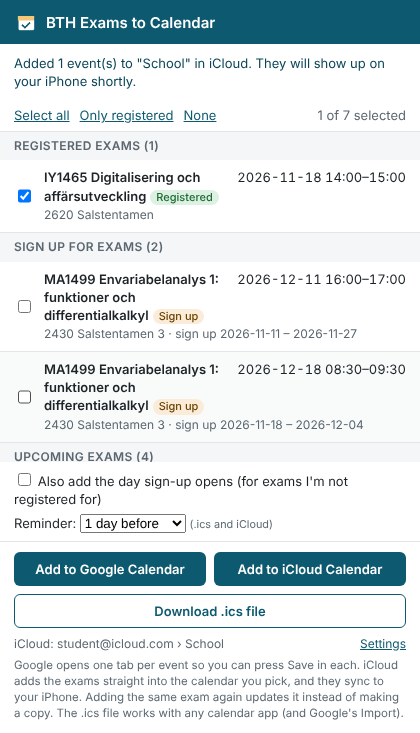

# tentamen.bth.se
Add ur exams to ur calendars fast :)

A Chrome extension (Manifest V3) that reads the **Exam Sign up** page on
[tentamen.bth.se](https://tentamen.bth.se/) and lets you pick which exams to put in
**Google Calendar**, **iCloud Calendar** (shows up on your iPhone) or an .ics file.



## How it works

1. Sign in on tentamen.bth.se yourself (Microsoft login, 2FA and all). The extension
   never logs in, stores passwords or talks to any server.
2. Open the **Exam Sign up** page and click the extension icon.
3. The extension reads the page you are looking at and lists:
   - exams you are **registered** for (pre-selected),
   - exams under **Sign up For Exams** (with their sign-up period),
   - the **Upcoming Exams** table (`.bth-table-content`). These have no time yet, so they
     become all-day events.
4. Tick the exams you want, then:
   - **Add to Google Calendar** opens one Google Calendar "new event" tab per exam,
     already filled in. Press Save in each.
   - **Add to iCloud Calendar** puts the exams straight into the iCloud calendar you pick, so
     they sync to your iPhone, iPad and Mac. See [iCloud setup](#icloud-setup) below.
   - **Download .ics file** saves `bth-exams.ics`. Open it on a Mac/iPhone to add to Apple
     Calendar, or import it in Google Calendar (Settings › Import & export) to add many
     exams at once. To get it onto an iPhone, AirDrop or e-mail the file to yourself.

Options: a reminder (1 hour / 1 day / 1 week before, .ics and iCloud) and an extra all-day
"Sign up opens" event for exams you haven't registered for yet, so you don't miss the
sign-up window (it opens 30 days and closes 14 days before the exam).

Times are written as Europe/Stockholm, and each event has a stable UID, so importing the
same .ics again updates the events instead of duplicating them (in calendars that honour
UIDs, like Apple Calendar).

## iCloud setup

Apple has no "add event" link like Google's, and your icloud.com login can't be used by
other apps. The supported way is iCloud's calendar sync (CalDAV) with an
**app-specific password**:

1. Go to [account.apple.com](https://account.apple.com/account/manage) › Sign-In and Security ›
   App-Specific Passwords, and create one (e.g. named "BTH exams").
2. In the extension popup click **Set up** next to "iCloud", enter your Apple ID e-mail and the
   app-specific password, and click **Connect**.
3. Pick which calendar the exams should go to.

The password is saved only in this browser (`chrome.storage.local`) and is only sent to Apple's
iCloud servers. **Disconnect** removes it. You can also revoke it at account.apple.com at any time.
Each exam is saved under a fixed name, so adding it again updates it instead of making a copy.

## Install (developer mode)

1. Download or clone this repo.
2. Go to `chrome://extensions` and turn on **Developer mode**.
3. Click **Load unpacked** and pick the repo folder (the one with `manifest.json`).

Permissions: `activeTab` + `scripting` + host access to `https://tentamen.bth.se/*` to read
the page when you click the icon, host access to `https://*.icloud.com/*` to add events to
iCloud, and `storage` to remember your options and iCloud login.

## Code

| File | What it does |
| --- | --- |
| `manifest.json` | Extension manifest (MV3) |
| `src/parser.js` | Reads exams from the page. Works on visible text and labels (`Date:`, `Time:`, `Sign up Period:`, Swedish `Datum:`/`Tid:` too) rather than exact class names, so small markup changes don't break it |
| `src/calendar.js` | Builds the .ics file and Google Calendar links |
| `src/caldav.js` | Small CalDAV client for iCloud (find calendars, save events) |
| `background.js` | Service worker that talks to iCloud for the popup |
| `popup/` | The popup UI |
| `test/` | Fixtures modelled on the real page plus tests |

## Tests

Tests use Playwright with Chromium:

```sh
npm i -D playwright && npx playwright install chromium   # once
node test/run-tests.js
node test/caldav-tests.js   # runs against a fake iCloud server in test/fake-icloud.js
```

The fixtures in `test/` were made from screenshots of the page, not its real HTML. If the
parser misses something on the live page, save the page's HTML (with your name and other
personal data removed) as a new fixture and add a test for it.
